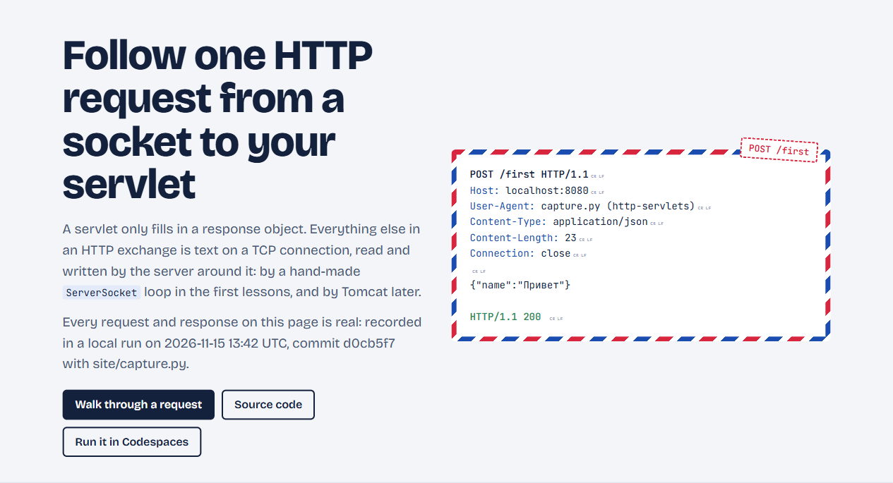
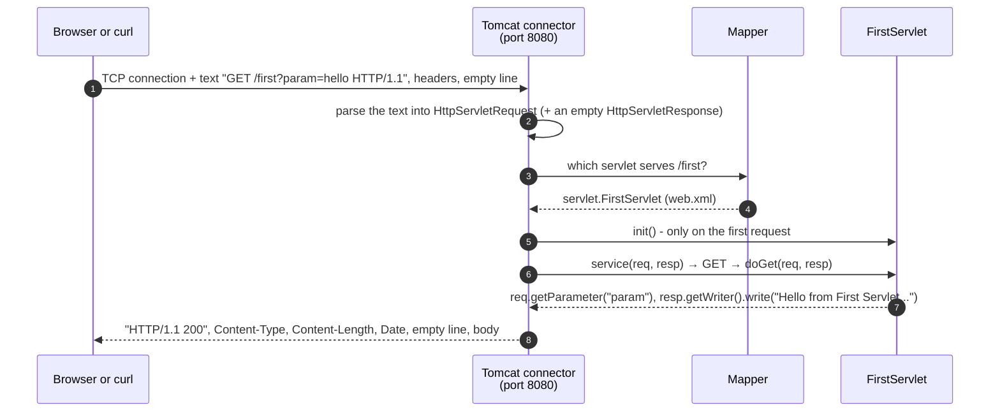
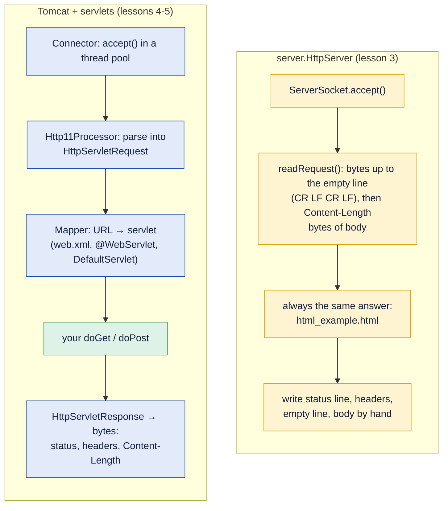
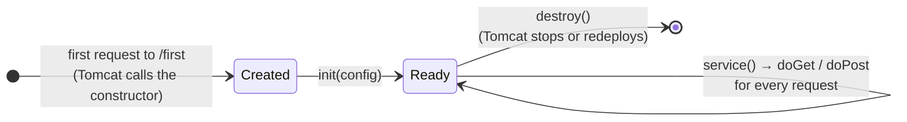
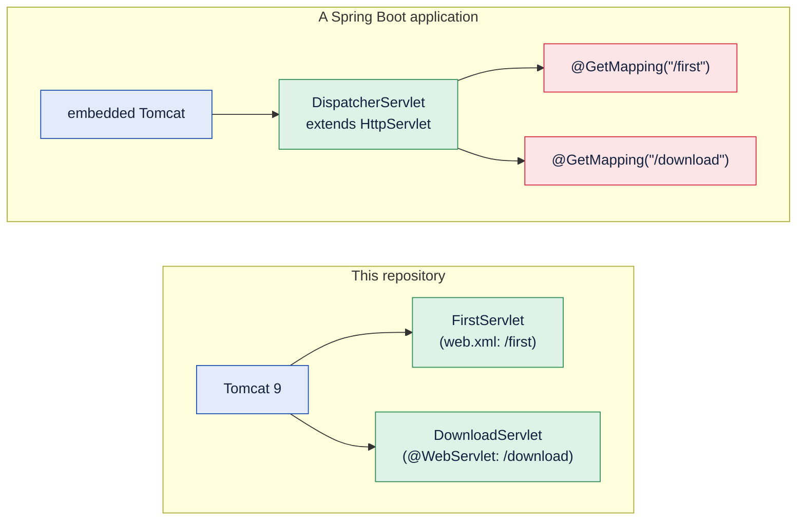
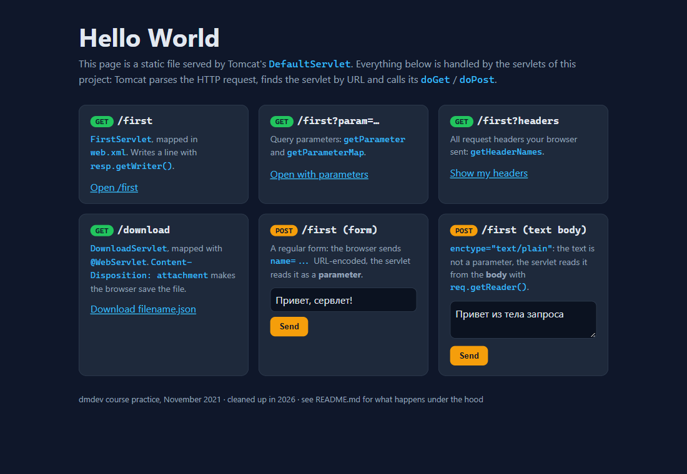
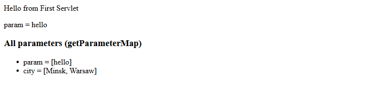
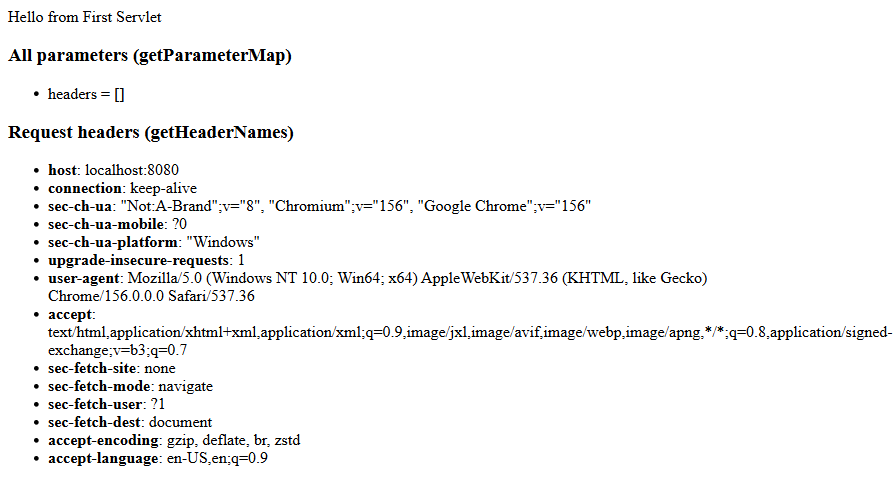
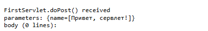

# Http_Servlets — HTTP and servlets from scratch (dmdev course, 2021)

[](https://github.com/DmitryDerkach/Http_Servlets/actions/workflows/ci.yml)
[](https://codespaces.new/DmitryDerkach/Http_Servlets?quickstart=1)

The Java code I wrote in **November 2021** while learning how the web works under a Java application, following the **dmdev** course (2 commits: sockets and HTTP clients on 2021-11-08, servlets on 2021-11-11). It comes right after my [JDBC](https://github.com/DmitryDerkach/JDBC) practice: first a request is sent and served **by hand** over a TCP socket, then the same job is handed to **Tomcat** and **servlets** — the layer that Spring MVC and Spring Boot are built on.

In 2026 I fixed the bugs I found, made the commented-out exercises runnable again, added explanations to every class and packed everything into **one command**: Tomcat 9 in Docker, the hand-made server with its clients, and JUnit tests that start a real embedded Tomcat. A GitHub Actions job runs all of it on every push (see [2026 clean-up](#2026-clean-up)).

[](https://dmitryderkach.github.io/Http_Servlets/)

**[Servlets under the hood](https://dmitryderkach.github.io/Http_Servlets/)** — an interactive page that walks a request through every stage, from the socket to `doGet()` and back. The requests and responses on it are recorded from this code by the CI on every deploy.

## Three ways to see it work

| | What you need | What you get |
|---|---|---|
| **[Codespaces](https://codespaces.new/DmitryDerkach/Http_Servlets?quickstart=1)** | a GitHub account | a cloud machine in the browser: Tomcat starts by itself and port 8080 opens in a new tab. The terminal has every `./run.sh` command |
| **[The page on GitHub Pages](https://dmitryderkach.github.io/Http_Servlets/)** | a browser | real recorded requests and responses, explained stage by stage. Nothing runs: it's a recording |
| **[Your machine](#how-to-run)** | JDK 11+ and Docker | `./run.sh` — everything below, on `localhost` |

## What's inside — the course path

| # | Topic | Where | What it shows |
|---|---|---|---|
| 1 | `URL` + `URLConnection` | `client.UrlExample` | The oldest HTTP client in Java (since 1.0). `get`: headers and body of `https://www.google.com`; `post`: sending a body (`setDoOutput(true)` *before* connecting); `file`: the same `URLConnection` reads a local file from a `file:` URL |
| 2 | `java.net.http.HttpClient` | `client.HttpClientExample` | The Java 11 client: `HttpClient` (settings), `HttpRequest` (built with a builder), `HttpResponse` with a `BodyHandler`; `get`, and `post` with `BodyPublishers.ofFile` |
| 3 | **A hand-made HTTP server** | `server.HttpServer`, `HttpServerRunner`, `HttpClientRunner` | HTTP is just text over TCP: a `ServerSocket` on port 9000 reads the request line, headers, empty line and body, and writes `HTTP/1.1 200 OK`, headers, an empty line and `html_example.html` back — all by hand |
| 4 | **Servlets on Tomcat** | `servlet.FirstServlet`, `WebContent/WEB-INF/web.xml` | Tomcat does the socket and parsing work, the servlet only handles `doGet` / `doPost`: the lifecycle (`init` / `destroy`), mapping in `web.xml`, query parameters (`getParameter`, `getParameterMap`), request headers, reading a body with `getReader()` and its encoding, writing with `getWriter()` |
| 5 | File download | `servlet.DownloadServlet` | Mapping with `@WebServlet("/download")` instead of XML; a file from the classpath (`getResourceAsStream`); `Content-Disposition: attachment` makes the browser save it |
| 6 | WAR | `pom.xml` → `target/http-servlets.war` | The packaged web application (in 2021: exported by hand from Eclipse into `WarfileStorage/`; now built by Maven) |

```mermaid
flowchart LR
    A["1 URLConnection<br/><i>client.UrlExample</i>"] --> B["2 HttpClient<br/><i>client.HttpClientExample</i>"]
    B --> C["3 Hand-made server<br/><i>server.HttpServer</i>"]
    C --> D["4 Servlets on Tomcat<br/><i>servlet.FirstServlet</i>"]
    D --> E["5 Download<br/><i>servlet.DownloadServlet</i>"]
    E --> F["6 WAR<br/><i>target/http-servlets.war</i>"]
    classDef client fill:#E3EBFB,stroke:#1B4DB1,color:#14213D
    classDef server fill:#FFF4D1,stroke:#E0A100,color:#14213D
    classDef servlet fill:#DFF2E7,stroke:#2E8B57,color:#14213D
    classDef war fill:#FCE4E7,stroke:#D7263D,color:#14213D
    class A,B client
    class C server
    class D,E servlet
    class F war
```



The package `socket` is a byte-for-byte copy of `server` (`HttpServer`, `HttpServerRunner`, `HttpClientRunner`). In the course this package held the TCP/UDP socket examples (a `DatagramRunner` is mentioned in a comment), but those files never made it into the repository. All comments in the code are in Russian, as I wrote them while watching the lessons; the `Описание (2026)` blocks at the top of every class explain what it does.

## Under the hood

### One request, from the socket to the servlet

What happens when the browser opens `http://localhost:8080/first?param=hello`. Only steps 6–7 are code from this repository; everything else is Tomcat:



### The same job by hand and by Tomcat

The hand-made `server.HttpServer` (yellow) is a few dozen lines that do, very simply, what Tomcat (blue) does before and after calling your servlet (green).



And this is what really goes over the socket — a request to the hand-made server and its answer, recorded with `site/capture.py` (`␍␊` is the `\r\n` that ends every line):

```
POST / HTTP/1.1␍␊
Host: localhost:9000␍␊
Content-Type: application/json␍␊
Content-Length: 603␍␊
␍␊                                 ← the empty line: headers end here
{ "glossary": { ... } }            ← exactly 603 bytes of body

HTTP/1.1 200 OK␍␊
content-type: text/html␍␊
content-length: 96␍␊
␍␊
<!DOCTYPE html> ... <h1>Hello World</h1> ...
```

### A servlet's life

Tomcat creates **one** `FirstServlet` object and calls it for every request, from many threads at the same time — so a servlet must not keep per-request data in its fields. `FirstServlet` prints its lifecycle to the Tomcat log (`./run.sh web` shows it):



### Why this matters for Spring

Spring MVC doesn't replace servlets, it is built on them. In a Spring Boot web application there is **one** servlet, `DispatcherServlet extends HttpServlet`, registered in an **embedded Tomcat** (the same `tomcat-embed-core` this project's tests use), and it forwards every request to your `@Controller` methods:



| | This repository (2021) | Spring Boot |
|---|---|---|
| Server | Tomcat installed separately, the WAR deployed into it | the same Tomcat inside the application jar |
| Mapping | `web.xml` or `@WebServlet("/download")` | `@GetMapping("/download")` |
| Request data | `req.getParameter(...)`, `req.getReader()`, `req.setCharacterEncoding("UTF-8")` | `@RequestParam`, `@RequestBody` |
| Response | `resp.getWriter().write(...)`, headers by hand | return an object, a message converter writes it |

## Repository structure

```
run.sh, run.ps1                 # 2026: one command: web / server / client / test / stop
docker-compose.yml              # 2026: Tomcat 9.0.123 with the application on port 8080
.devcontainer/                  # 2026: GitHub Codespaces (JDK 17 + Docker, starts ./run.sh web)
.github/workflows/ci.yml        # 2026: tests + every run.sh mode on Java 11, 17 and 21; publishes the page
site/                           # 2026: the "under the hood" page (GitHub Pages) and capture.py that records it
docs/images/                    # 2026: screenshots for this README
Http_Servlets/
├── src/
│   ├── client/                 # UrlExample, HttpClientExample (lessons 1-2)
│   ├── server/                 # HttpServer, HttpServerRunner, HttpClientRunner (lesson 3)
│   ├── socket/                 # a copy of server/
│   ├── servlet/                # FirstServlet, DownloadServlet (lessons 4-5)
│   └── resources/              # html_example.html (the hand-made server's answer), json_example.json
├── WebContent/
│   ├── index.html              # the start page (2026: links to every servlet and two POST forms)
│   └── WEB-INF/web.xml         # welcome files, the /first mapping
├── test/                       # 2026: JUnit 5 tests (embedded Tomcat, the hand-made server, the clients)
├── pom.xml                     # 2026: Maven WAR build (the Eclipse layout is kept)
└── mvnw, mvnw.cmd, .mvn/       # 2026: Maven Wrapper
```

## How to run

**Requirements:**

- **JDK 11 or newer** (`java -version` must work, or `JAVA_HOME` must point to a JDK);
- **Docker** with Docker Compose v2 (`docker compose`), running — only for `./run.sh web` (Tomcat). On Windows/macOS start Docker Desktop first.

Nothing else: Maven, the libraries and the Tomcat image are downloaded on the first run (needs internet once).

### One command

From the repository root:

```bash
./run.sh              # Linux, macOS, Git Bash on Windows
```

```powershell
.\run.ps1             # Windows PowerShell
```

This builds the WAR, starts **Tomcat 9** in Docker, calls every servlet with `curl`, shows what the servlets printed to the Tomcat log, and **leaves Tomcat running**: open **<http://localhost:8080/>** in a browser.

All commands (the same for `run.ps1`):

| Command | What it does | Needs Docker |
|---|---|---|
| `./run.sh` or `./run.sh web` | build the WAR, (re)start Tomcat on port 8080, call every servlet | yes |
| `./run.sh server` | start the hand-made `server.HttpServer` on port 9000, send it requests from `curl`, `HttpClientRunner`, `UrlExample post` and `HttpClientExample post`, print what the server received, stop it | no |
| `./run.sh server socket` | the same with the copy in the `socket` package | no |
| `./run.sh client` | the internet examples: `UrlExample get`, `UrlExample file`, `HttpClientExample get` (google.com) | no |
| `./run.sh test` | the JUnit tests (21), Tomcat embedded in the test | no |
| `./run.sh stop` | stop and remove the Tomcat container | yes |

Example — the end of `./run.sh web`:

```
== curl -i http://localhost:8080/first ==
HTTP/1.1 200
Content-Type: text/html;charset=UTF-8
Content-Length: 24
Date: Sun, 15 Nov 2026 13:35:03 GMT

Hello from First Servlet

== curl http://localhost:8080/first?param=hello&city=Minsk&city=Warsaw ==
Hello from First Servlet<p>param = hello</p><h3>All parameters (getParameterMap)</h3><ul><li>param = [hello]</li><li>city = [Minsk, Warsaw]</li></ul>

...

== curl -X POST -H "Content-Type: application/json" --data-binary '{"name":"Привет"}' http://localhost:8080/first ==
FirstServlet.doPost() received
parameters: {}
body (1 lines):
{"name":"Привет"}

== Tomcat log: what the servlets printed with System.out ==
FirstServlet.init(): the servlet is created
{}
{"name":"Привет"}

== Tomcat is running: open http://localhost:8080/ in a browser (./run.sh stop stops it) ==
```

And the end of `./run.sh server` — what the hand-made server received from `HttpClientRunner`:

```
== What server.HttpServer received (its console) ==
Request: GET / HTTP/1.1
Host: localhost:9000
User-Agent: curl/8.17.0
Accept: */*

Request: POST / HTTP/1.1
Content-Length: 603
Host: localhost:9000
User-Agent: Java-http-client/17.0.20
content-type: application/json

{
    "glossary": {
...
```

### In the browser

With Tomcat running (`./run.sh web`):

| URL | Handled by | What you see |
|---|---|---|
| <http://localhost:8080/> | Tomcat's `DefaultServlet` (the file `WebContent/index.html`) | the start page with links and two forms |
| <http://localhost:8080/first> | `FirstServlet.doGet` | `Hello from First Servlet` |
| <http://localhost:8080/first?param=hello&city=Minsk&city=Warsaw> | `FirstServlet.doGet` | the parameters, both values of `city` |
| <http://localhost:8080/first?headers> | `FirstServlet.doGet` | every header your browser sent (also printed to the Tomcat log) |
| <http://localhost:8080/download> | `DownloadServlet.doGet` | the browser saves `filename.json` |
| the forms on the start page | `FirstServlet.doPost` | a regular form arrives as a **parameter**, an `enctype="text/plain"` form as the request **body** |



`/first?param=hello&city=Minsk&city=Warsaw`:



`/first?headers` in Chrome:



The regular form sent with Cyrillic text (`doPost` reads it as UTF-8):



### In GitHub Codespaces

Click **[Open in GitHub Codespaces](https://codespaces.new/DmitryDerkach/Http_Servlets?quickstart=1)**. The first start takes a few minutes (it builds a machine with JDK 17 and Docker); then `./run.sh web` runs by itself and port 8080 opens in the browser. Every command from the table works in the codespace terminal. Codespaces are free for personal accounts within GitHub's monthly quota; stop or delete the codespace when you are done.

### Without the scripts

```bash
cd Http_Servlets
./mvnw package                       # tests + target/http-servlets.war   (Windows: .\mvnw.cmd ...)
cd ..
docker compose up -d --wait          # Tomcat 9 with target/http-servlets/ as the ROOT application
docker compose logs tomcat           # the Tomcat log
docker compose down                  # stop
```

Or deploy `Http_Servlets/target/http-servlets.war` to **your own Tomcat 9** (Tomcat 10+ won't load it: it uses `jakarta.servlet` instead of `javax.servlet`): copy it to `webapps/ROOT.war` to get the same URLs as above, or to `webapps/` to get them under `/http-servlets/`.

The hand-made server and the clients are plain `main` methods. Run them from the `Http_Servlets` folder (they read `src/resources/...` relative to it):

```bash
cd Http_Servlets
./mvnw -q compile
java -cp target/classes server.HttpServerRunner                 # terminal 1: the server (Ctrl+C stops it)
java -cp target/classes server.HttpClientRunner                 # terminal 2: a POST to it
java -cp target/classes client.UrlExample post                  # or: get, file
java -cp target/classes client.HttpClientExample post           # or: get
```

On Windows add `-Dstdout.encoding=UTF-8` to `java` if Cyrillic comes out as `?????`.

### From an IDE

- **IntelliJ IDEA:** *File → Open* → `Http_Servlets/pom.xml` → *Open as Project*. The tests (`test/`) and every `main` (`HttpServerRunner`, `UrlExample`…) run directly; the working directory must be the `Http_Servlets` folder (the default for a Maven project). For the servlets use `./run.sh web`, or a Tomcat 9 run configuration if your IDE has one.
- **Eclipse** (as in 2021): *File → Import → Maven → Existing Maven Projects* → the `Http_Servlets` folder; the servlets run with *Run As → Run on Server* on a Tomcat 9 server.

### Troubleshooting

| Problem | Fix |
|---|---|
| `docker compose` fails to connect to Docker | Start Docker Desktop (or the Docker service) and wait until it's running. |
| Port 8080 is already in use | Another program (often another Tomcat) listens on 8080. Use another port: `TOMCAT_PORT=8081 ./run.sh web` (PowerShell: `$env:TOMCAT_PORT = "8081"; .\run.ps1 web`), then open `http://localhost:8081/`. |
| `Port 9000 is already in use` from `./run.sh server` | A server from an earlier run is still running (or another program): stop it. |
| `./run.sh client` fails with `UnknownHostException` / a timeout | These examples go to `https://www.google.com` and need internet. `./run.sh server` does the same requests locally. |
| `./run.sh: Permission denied` | `bash run.sh`, or `chmod +x run.sh Http_Servlets/mvnw` once. |
| `.\run.ps1 cannot be loaded because running scripts is disabled` | Run it as `powershell -ExecutionPolicy Bypass -File .\run.ps1`. |
| `NoSuchFileException: src\resources\...` in an IDE | Set the run configuration's working directory to `Http_Servlets`. |

## 2026 clean-up

In 2026 I ran the original code (the server and clients directly, the servlets on Tomcat 9) and fixed what I found. Every change in the code is marked with a `// fix 2026: ...` comment, and additions that are not fixes with `// 2026: ...`; class descriptions in Russian (`/* Описание (2026): ... */`) were added at the top of every class.

**Bugs fixed:**

- **The hand-made server hung on short requests.** It read the request with `readNBytes(400)`, which waits for exactly 400 bytes: `curl` or a short request hung the server until the client gave up (`Connection reset`), and a longer one was cut after 400 bytes. It now reads the headers up to the empty line and then exactly `Content-Length` bytes of the body.
- **The hand-made server answered once and exited**, and never closed its `ServerSocket`. It now accepts connections in a loop.
- **Line endings in the server's answer:** header lines ended with `\n` instead of `\r\n` (HTTP requires `\r\n`), and the empty line was `System.lineSeparator()` — `\r\n` on Windows but `\n` on Linux.
- **`UrlExample` crashed:** `setDoOutput(true)` was called after the connection was already open (`IllegalStateException: Already connected`), followed by `write(null)` (a guaranteed `NullPointerException`); the body was opened but never read, and `getContent().toString()` printed an object name instead of text. Each step is now a separate example (`get`, `post`, `file`) and works.
- **`POST /first` garbled Cyrillic text:** the body was read without an encoding (ISO-8859-1 by default), so `Привет` arrived as `ÐÑивеÑ`. `doPost` now calls `setCharacterEncoding("UTF-8")` first. It also returned an empty answer; now it answers with what it received.
- **`DownloadServlet`** threw a `NullPointerException` (500) when the file was missing from the classpath; now it answers 404. The exported `archive.war` from 2021 contained an older version that used `getSystemResourceAsStream` and served an empty file.
- **Parameters on the page are HTML-escaped:** showing them as-is would let `?param=<script>...` run in the browser.
- **Dead code restored:** printing all request headers (now `/first?headers`), the parameter map in `doPost`, the POST from a file in `HttpClientExample` (it had a placeholder path), and reading a local file through a `file:` URL in `UrlExample` (it pointed to `C:\workspace\...`, to a file that isn't in the repository).

**One command and tests:**

- **Maven** (`pom.xml`, WAR packaging, the original Eclipse layout `src/` + `WebContent/` kept) + Maven Wrapper instead of an Eclipse project tied to a local Tomcat 8.5. Tomcat 8.5 is end-of-life; the project now runs on **Tomcat 9.0.123** (the newest line with the same `javax.servlet` API).
- `run.sh` / `run.ps1` with the modes `web`, `server`, `client`, `test`, `stop`; Tomcat in Docker (`docker-compose.yml`).
- **JUnit 5 tests** (21): the servlets on an **embedded Tomcat** (no Docker needed), both copies of the hand-made server through a raw socket (short request, several requests in a row, `\r\n`, the whole POST body), and the client examples against a local server. I checked with mutations that the tests fail when any of the fixes they cover is reverted (13 mutations, one per fix).
- **CI:** GitHub Actions runs the tests and every `run.sh` mode on Java 11, 17 and 21, and checks Tomcat's answers with `curl`.
- **Codespaces** (`.devcontainer/`) and the **"under the hood" page** on GitHub Pages: the CI records real requests and responses from this code on every deploy (`site/capture.py`).
- `WebContent/index.html` was only `Hello World`; it is now a start page with links to every servlet and two POST forms (the `Hello World` heading is kept).
- **Housekeeping:** removed the Eclipse project files and the exported `WarfileStorage/archive.war` from Git (Maven builds the WAR now).
- **Typos fixed** in identifiers (`paremeterMap` → `parameterMap`, `parametrsMap` → `parametersMap`, `fileCheker` → `fileChecker`) and in the Russian comments (`возсожные` → `возможные`, `которе` → `которые`, `строкми` → `строками`, `Получение тело` → `Получение тела`; a POST comment said the data goes "to our client" — it goes to the server).

The rest of the code is intentionally left as I wrote it in 2021.

### Known issues (left as-is)

- The hand-made server serves **one connection at a time**: a client that connects and sends nothing blocks everybody else. A real server (like Tomcat) uses a thread pool and timeouts; for a lesson about the HTTP format it stays simple. It also understands only `Content-Length` bodies (no `Transfer-Encoding: chunked`) and always answers with the same file.
- `socket` is a copy of `server` (see above); the hand-made server's port 9000 and the paths `src/resources/...` are hard-coded, so the programs run from the `Http_Servlets` folder.
- `UrlExample get` and `HttpClientExample get` need internet and print only the beginning of Google's page (the whole page is tens of kilobytes on one line).
- `FirstServlet.init()` calls `config.getServletContext()` and ignores the result; a few unused imports and the IDE's `// TODO Auto-generated method stub` are still there.

## Credits

`src/resources/json_example.json` is the "glossary" sample from [json.org/example.html](https://json.org/example.html), used in the course as test data.
